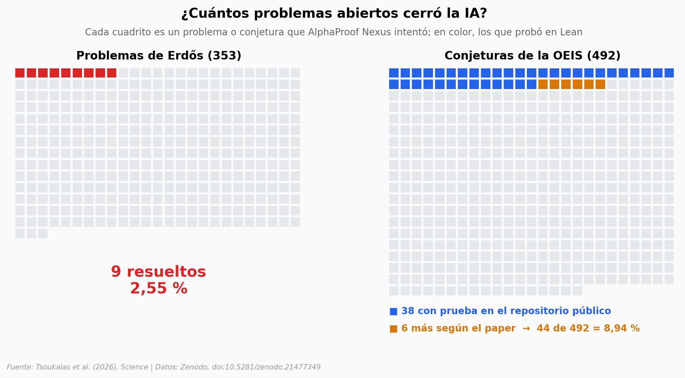

# Una IA contra 353 problemas abiertos de Erdős

Un agente de inteligencia artificial que escribe sus pruebas en Lean, un lenguaje donde el compilador revisa cada paso, intentó 353 problemas abiertos de Erdős y resolvió 9. Abrimos las 71 pruebas que publicaron en Zenodo para ver cómo son por dentro, y comparamos lo que lograron otros sistemas con los mismos problemas.

**El hallazgo:** **9 de 353 problemas de Erdős (2,55 %) y 44 de 492 conjeturas de la OEIS según el paper; las pruebas de Erdős son unas 3,8 veces más largas que las de la OEIS (mediana 764 contra 199 líneas).**

## Gráfica clave



## Reproducir

[](https://colab.research.google.com/github/Ciencia-a-Mordiscos/lab/blob/main/papers/2026-10-08-ia-busqueda-pruebas-formales-erdos/notebook.ipynb)

O localmente:
```bash
pip install pandas matplotlib numpy scipy
jupyter execute notebook.ipynb
```

## Datos

- `datos/pruebas_lean.csv`: 71 archivos Lean (69 pruebas completas y 2 parciales) con dominio, líneas de código, lemas auxiliares y respuesta formal
- `datos/tacticas_por_prueba.csv`: conteo léxico de 30 tácticas de Lean por archivo (2.130 filas)
- `datos/problemas_intentados.csv`: los 353 problemas de Erdős y las 492 conjeturas OEIS intentadas (845 filas)
- `datos/comparacion_sistemas_erdos.csv`: problemas de Erdős resueltos por otros sistemas (7 filas, transcrito del material suplementario)

## Links

- **Video:** [Pendiente]
- **Paper:** [Science — DOI: 10.1126/science.aej2213](https://doi.org/10.1126/science.aej2213)
- **Datos originales:** [Zenodo — alphaproof-nexus-results](https://doi.org/10.5281/zenodo.21477349) · [Formal Conjectures (GitHub)](https://github.com/google-deepmind/formal-conjectures)
