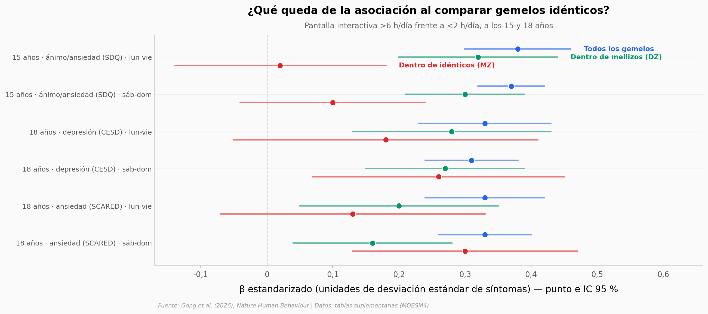

# Pantallas, ansiedad y gemelos idénticos

En 21.797 gemelos suecos seguidos desde los 9 hasta los 24 años, los adolescentes que pasan más de 6 horas diarias con pantallas interactivas tienen más síntomas de ansiedad y depresión. Pero cuando cada uno se compara con su gemelo idéntico (mismos genes, mismo hogar), la asociación se encoge: los datos sugieren que factores genéticos y familiares compartidos la explican en parte.

**El hallazgo:** **a los 15 años, entre semana, el coeficiente pasa de 0,38 en todos los gemelos a 0,02 dentro de gemelos idénticos** — aunque con la tele el patrón no se repite y 2 de 12 comparaciones entre idénticos siguen siendo significativas.

## Gráfica clave



## Reproducir

[](https://colab.research.google.com/github/Ciencia-a-Mordiscos/lab/blob/main/papers/2026-10-08-pantallas-gemelos-ansiedad-depresion/notebook.ipynb)

O localmente:
```bash
pip install pandas matplotlib numpy
jupyter execute notebook.ipynb
```

## Datos

Todos salen de las Supplementary Tables del paper (MOESM4). Los microdatos del Swedish Twin Registry no son públicos.

- `datos/transversal_beta.csv` — β por nivel de uso a los 9, 15 y 18 años; todos, dentro de mellizos y dentro de idénticos (264 filas)
- `datos/transversal_por_sexo.csv` — β por sexo y p de interacción (132 filas)
- `datos/entre_edades_beta.csv` — uso a una edad → síntomas años después (219 filas)
- `datos/clinico_hr.csv` — diagnósticos clínicos: eventos, persona-año, tasas y HR (642 filas)
- `datos/correlaciones_gemelos.csv` — correlaciones entre gemelos MZ y DZ (76 filas)
- `datos/uso_por_sexo.csv` — n por nivel de uso y sexo (114 filas)

## Links

- **Video:** [Pendiente]
- **Paper:** [Nature Human Behaviour — DOI: 10.1038/s41562-026-02607-0](https://doi.org/10.1038/s41562-026-02607-0)
- **Datos originales:** [Supplementary Tables (MOESM4)](https://media.springernature.com/original/springer-static/esm/art%3A10.1038%2Fs41562-026-02607-0/MediaObjects/41562_2026_2607_MOESM4_ESM.xlsx)
