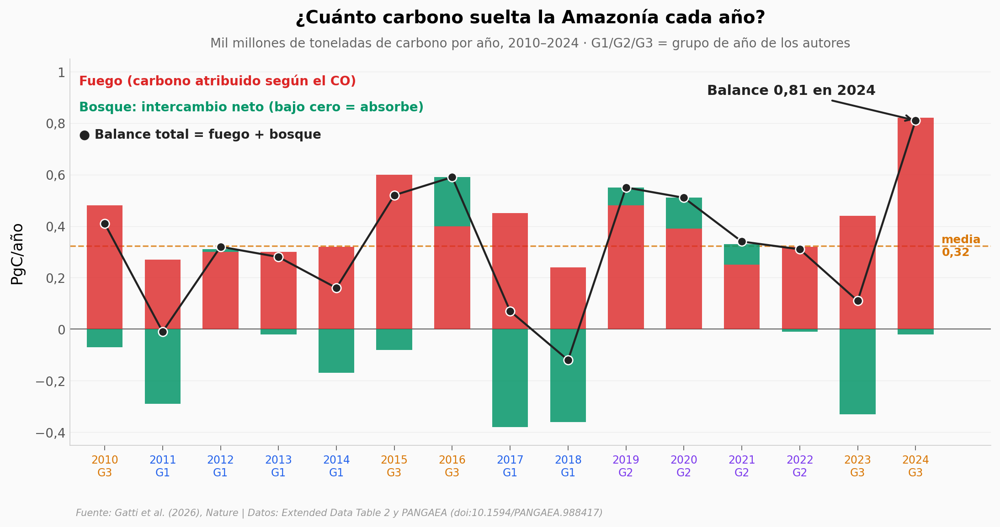

# La Amazonía, entre el fuego y la sequía

Quince años de vuelos de avioneta sobre la Amazonía brasileña (2010–2024) permiten reconstruir cuánto carbono gana el aire al cruzar la selva. El balance sale positivo en 13 de 15 años: en su conjunto, la región fue fuente neta de carbono. La selva absorbe neto en 10 de esos años, pero no le alcanza para compensar lo que se quema.

**El hallazgo:** **el carbono atribuido al fuego (0,40 PgC/año) supera al balance total medio (0,32 PgC/año)**. En 2024, el peor año de la serie, el balance llegó a 0,81 PgC/año, unos 810 millones de toneladas de carbono. Con solo 15 años, eso sí, la serie no muestra una tendencia estadística: el «debilitamiento» del sumidero es la conclusión de los autores.

## Gráfica clave



## Reproducir

[](https://colab.research.google.com/github/Ciencia-a-Mordiscos/lab/blob/main/papers/2026-10-21-amazonia-emisiones-carbono-incendios-sequia/notebook.ipynb)

O localmente:
```bash
pip install pandas matplotlib numpy scipy
jupyter execute notebook.ipynb
```

## Datos

- `datos/amazonia_anual.csv` — balance, fuego, intercambio del bosque, clima, área quemada y deforestación de la Amazonía, 2010–2024 (15 filas; Extended Data Table 2)
- `datos/regiones_anual.csv` — lo mismo para las cuatro regiones de influencia de los sitios de vuelo (60 filas; Extended Data Table 2)
- `datos/perfiles_dco2.csv` — CO₂ medio sobre el fondo en cada perfil de avión (948 perfiles, 9.178 muestras; PANGAEA)
- `datos/perfil_vertical_por_grupo.csv` — CO₂ medio sobre el fondo por banda de 500 m y grupo de años (27 filas; PANGAEA)

## Links

- **Video:** [Pendiente]
- **Paper:** [Nature — DOI: 10.1038/s41586-026-11168-1](https://doi.org/10.1038/s41586-026-11168-1)
- **Datos originales:** [Extended Data Table 2](https://www.nature.com/articles/s41586-026-11168-1/tables/2) · [PANGAEA — doi:10.1594/PANGAEA.988417](https://doi.org/10.1594/PANGAEA.988417)
