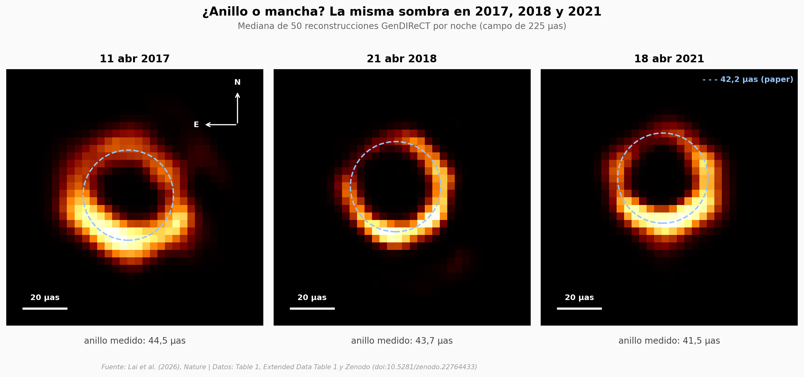

# La sombra de M87*, a prueba de errores de calibración

En 2019 el Event Horizon Telescope mostró un anillo de luz alrededor del agujero negro de M87, pero la imagen dependía de cómo se calibraban las antenas y de cómo se armaba, y hubo análisis que dudaron de que fuera un anillo. Lai et al. (2026) lo reconstruyen con un algoritmo propio que usa invariantes de cierre (medidas que no dependen de la calibración de cada antena) y que no impone la forma de anillo. Aquí abrimos sus reconstrucciones y sus tablas.

**El hallazgo:** **el anillo reaparece en 2017, 2018 y 2021 con un diámetro medio de 42,2 μas, el mismo que da un anillo geométrico ajustado sin pasar por la imagen (42,26 μas), y eso equivale a unos 6.500 millones de soles si se asume α = 11 y D = 16,8 Mpc.**

## Gráfica clave



## Reproducir

[](https://colab.research.google.com/github/Ciencia-a-Mordiscos/lab/blob/main/papers/2026-11-11-sombra-de-m87-confirmada-sin-calibracion/notebook.ipynb)

O localmente:
```bash
pip install pandas matplotlib numpy scipy
jupyter execute notebook.ipynb
```

## Datos

- `datos/anillo_por_fecha_imagen.csv` — propiedades del anillo por noche medidas sobre las imágenes (Table 1), 8 noches de 2017 a 2021
- `datos/anillo_por_fecha_geometrico.csv` — las mismas propiedades con un anillo geométrico ajustado a los invariantes de cierre (Extended Data Table 1, transcrita de imagen), 8 noches
- `datos/M87_*_225_muestras.npy` — 50 reconstrucciones de 64×64 píxeles (campo de 225 μas) por noche, para 11/04/2017, 21/04/2018 y 18/04/2021
- `datos/diametro_por_muestra_fov225.csv` — diámetro del anillo re-medido en cada una de las 150 reconstrucciones

## Links

- **Video:** [Pendiente]
- **Paper:** [Nature — DOI: 10.1038/s41586-026-11241-9](https://doi.org/10.1038/s41586-026-11241-9)
- **Datos originales:** [Zenodo — GenDIReCT v1.1.0-paperM87](https://doi.org/10.5281/zenodo.22764433)
