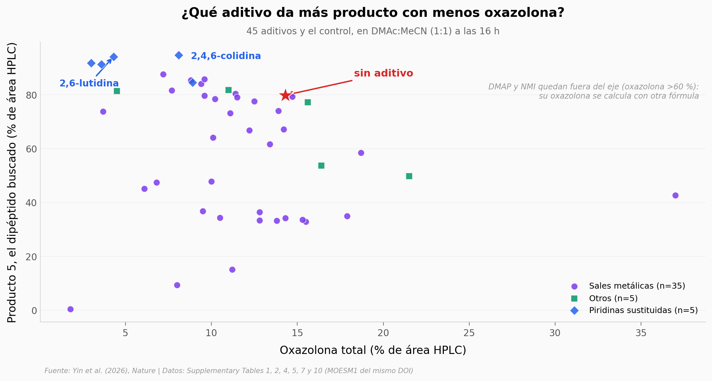

# Copiar al ribosoma: péptidos de la cabeza a la cola, sin proteger nada

El ribosoma ensambla péptidos sin proteger un solo aminoácido y lo hace de la cabeza a la cola (N → C). La química de laboratorio lleva décadas yendo al revés y poniendo y quitando grupos protectores en cada paso. Este equipo montó la versión continua del camino del ribosoma, y el cuello de botella tiene nombre: la oxazolona, el anillo que se forma al activar el ácido y devuelve la cadena con el carbono girado. Exploramos sus tablas de cribado para ver qué hizo falta para taparle la puerta.

**El hallazgo:** de 47 aditivos probados, solo **13 mejoran el control**; con 2,6-lutidina el producto sube de **79,8 % a 94,1 %** de área HPLC, la oxazolona total cae **3,33 veces** (14,3 % → 4,3 %) y el epímero baja de 2,2 % a 0,6 %.

## Gráfica clave



## Reproducir

[](https://colab.research.google.com/github/Ciencia-a-Mordiscos/lab/blob/main/papers/2026-11-23-sintesis-continua-peptidos-n-a-c/notebook.ipynb)

O localmente:
```bash
pip install pandas matplotlib numpy scipy
jupyter execute notebook.ipynb
```

## Datos

Todas las cifras son **% de área por HPLC a 210 nm** (pureza relativa en la mezcla de reacción), no rendimiento aislado.

- `datos/aditivos_screening.csv` — Supplementary Table 2: 47 aditivos y el control, en DMAc y en DMAc:MeCN (1:1). 96 filas
- `datos/reagentes_activacion.csv` — Supplementary Table 1: 8 reactivos de acoplamiento y activación a 16 h. 8 filas
- `datos/lutidina_dosis.csv` — Supplementary Table 5: dosis-respuesta de 2,6-lutidina, de 0 a 2,0 equivalentes, a 5 h. 8 filas
- `datos/lutidina_momento.csv` — Supplementary Table 4: momento de adición de la lutidina (nunca, a los 30 min, desde el inicio), a 20 h. 3 filas
- `datos/cinetica_activacion.csv` — Supplementary Table 7: cinética de activación, 4 condiciones de base por 8 tiempos (10 min a 20 h). 32 filas
- `datos/agua_tolerancia.csv` — Supplementary Table 10: tolerancia al agua (0 a 15 equivalentes) con y sin lutidina. 10 filas

## Links

- **Video:** [Pendiente]
- **Paper:** [Nature — DOI: 10.1038/s41586-026-11448-w](https://doi.org/10.1038/s41586-026-11448-w)
- **Datos originales:** [Supplementary Information del mismo DOI (MOESM1)](https://static-content.springer.com/esm/art%3A10.1038%2Fs41586-026-11448-w/MediaObjects/41586_2026_11448_MOESM1_ESM.pdf)
