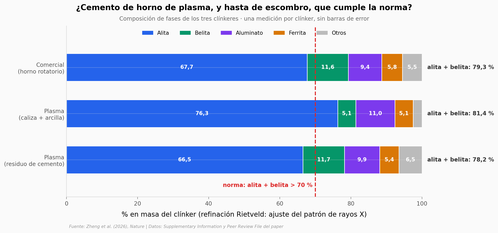

# Cemento en segundos con plasma: ¿cumple la norma, cuánto cuesta y cuánto CO₂ ahorra?

Un equipo cambió el horno rotatorio de llamas por un plasma de carbono encendido con microondas: el clínker se cuece en segundos en vez de horas. Abrimos el material suplementario del paper para ver si el clínker cumple la norma y para rehacer las cuentas de costo y CO₂ del modelo de los autores. El clínker pasa; las cifras de costo vienen en dos versiones que no cuadran del todo con la figura del propio modelo.

**El hallazgo:** los tres clínkeres superan el 70 % de alita + belita que pide la norma (79,3 % el comercial, 81,4 % el de plasma y 78,2 % el de residuo de cemento), y con electricidad renovable el CO₂ bajaría de 927 a 85,8 kg por tonelada de clínker.

## Gráfica clave



## Reproducir

[](https://colab.research.google.com/github/Ciencia-a-Mordiscos/lab/blob/main/papers/2026-11-25-cemento-plasma-microondas-fase-liquida/notebook.ipynb)

O localmente:
```bash
pip install pandas matplotlib numpy
jupyter execute notebook.ipynb
```

## Datos

- `datos/fases_clinker_rietveld.csv` — composición de fases de 3 clínkeres (Rietveld, SI Figs. S7-S9)
- `datos/costo_vs_precio_electricidad.csv` — 15 puntos de costo frente a precio de la electricidad (Peer Review File, Fig. R6, digitalizada)
- `datos/costo_vs_capacidad.csv` — 11 puntos de costo frente a capacidad de planta, 0,5 a 5 Mt/año (SI Fig. S21, digitalizada)
- `datos/escenarios_costo_texto.csv` — 12 escenarios de costo citados en el texto del SI y del expediente (incluye las dos versiones de la frase de costo)
- `datos/costo_cemento_convencional.csv` — costo del cemento convencional por componente
- `datos/co2_por_tonelada.csv` — kg de CO₂ por tonelada de clínker, convencional y plasma (Peer Review File R14)
- `datos/reduccion_global_co2.csv` — reducción global proyectada (SI Tabla S3)
- `datos/tea_entradas.csv` — 20 entradas del modelo tecnoeconómico (SI Tabla S2)

## Links

- **Video:** [Pendiente]
- **Paper:** [Nature — DOI: 10.1038/s41586-026-11313-w](https://doi.org/10.1038/s41586-026-11313-w)
- **Datos originales:** [Supplementary Information](https://static-content.springer.com/esm/art%3A10.1038%2Fs41586-026-11313-w/MediaObjects/41586_2026_11313_MOESM1_ESM.pdf) · [Peer Review File](https://static-content.springer.com/esm/art%3A10.1038%2Fs41586-026-11313-w/MediaObjects/41586_2026_11313_MOESM2_ESM.pdf)
