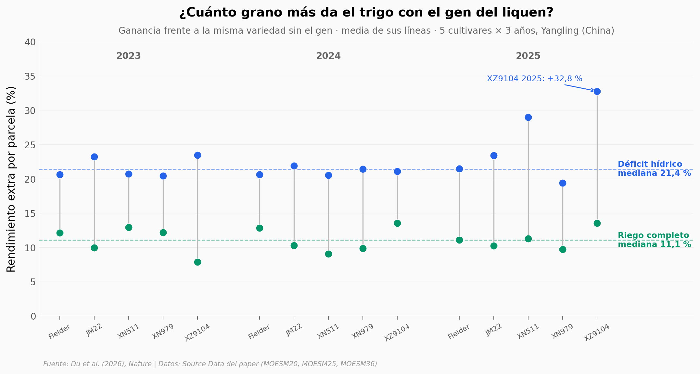

# Un gen prestado de un liquen: ¿cuánto grano más da el trigo en sequía?

Un equipo tomó *EpTFIIAγ*, un gen del hongo de un liquen que aguanta la sequía extrema, y lo metió en cinco variedades de trigo, en arroz y en maíz. Con la Source Data del paper reproducimos sus cifras de campo: el trigo con el gen rinde más con riego completo y, sobre todo, con déficit hídrico; pierde menos con la sequía en los 15 cultivar-año, pero sigue rindiendo menos que la variedad original bien regada.

**El hallazgo:** con déficit hídrico, el trigo con el gen rinde **entre 19,4 % y 32,8 % más por parcela** (mediana 21,4 %), y la sequía le cuesta una mediana de 26,8 % del rendimiento en vez de 31,8 %.

## Gráfica clave



## Reproducir

[](https://colab.research.google.com/github/Ciencia-a-Mordiscos/lab/blob/main/papers/2026-11-25-gen-extremofilo-sequia-cereales/notebook.ipynb)

O localmente:
```bash
pip install pandas matplotlib numpy scipy
jupyter execute notebook.ipynb
```

## Datos

- `datos/trigo_parcelas.csv` — rendimiento por parcela (kg), 5 cultivares × 3 años × 2 riegos, 4 parcelas por línea (384 filas)
- `datos/trigo_plantas.csv` — rendimiento de grano por planta (g), Yangling 2023-2025 (8.796 plantas)
- `datos/trigo_rasgos_resumen.csv` — media, desviación estándar y n por rasgo, línea, año y riego (1.152 filas)
- `datos/trigo_ganancia_cultivar_anio.csv` — ganancia % de la media de líneas con el gen frente a su control (30 filas)
- `datos/trigo_perdida_por_sequia.csv` — caída del rendimiento por sequía, control y con el gen (15 cultivar-año)
- `datos/trigo_lineas_efecto.csv` — diferencia en kg, d de Cohen, Welch y Mann-Whitney por línea a nivel parcela (66 filas)
- `datos/trigo_sitios_aridos_2025.csv` — rendimiento por planta en Heyang, Linfen y Cangzhou, 2025 (2.700 plantas)
- `datos/arroz_maiz_plantas.csv` — rendimiento por planta de arroz (Hanzhong 2023-2024) y maíz (Zhangye, Changji, Aksu) (744 plantas)

## Links

- **Video:** [Pendiente]
- **Paper:** [Nature — DOI: 10.1038/s41586-026-11151-w](https://doi.org/10.1038/s41586-026-11151-w)
- **Datos originales:** [Source Data y Supplementary Tables del paper (MOESM20, MOESM25, MOESM36)](https://doi.org/10.1038/s41586-026-11151-w)
