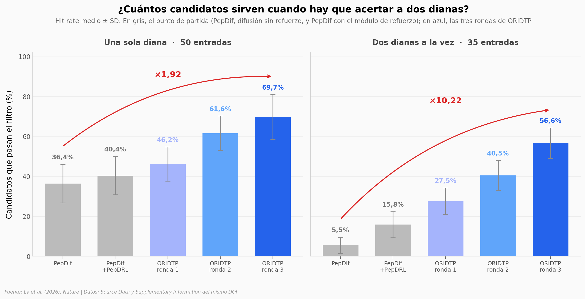

# ¿Puede una IA diseñar un péptido que acierte a dos dianas a la vez?

Diseñar un péptido que se pegue fuerte a dos receptores distintos es un problema aparte de diseñarlo para uno solo: cada cambio que mejora un acoplamiento suele empeorar el otro. ORIDTP, la plataforma de IA de este paper, combina transferencia de conocimiento desde el diseño de una sola diana con refuerzo sobre las dos a la vez. En el filtro computacional para dos dianas pasa del 5,5 % de candidatos útiles al 56,6 %. De los 20 péptidos sintetizados contra los receptores de GLP-1 y glucagón, 6 superan a las dos hormonas naturales; el mejor baja el peso de ratones obesos un 26,0 % a 1,5 nmol/kg, diez veces menos dosis que la semaglutida del grupo comparador. Y sin reentrenar nada, la plataforma diseñó péptidos contra PD-1 y CTLA-4: uno de ellos redujo el volumen del tumor de ratones un 94,2 %.

**El hallazgo:** **el acierto en el régimen de dos dianas se multiplica por 10,22 (5,5 % → 56,6 %), y el péptido líder reduce el tumor un 94,2 % frente al control — todo en ratones, ratas y células: no hay ensayos clínicos.**

## Gráfica clave



## Reproducir

[](https://colab.research.google.com/github/Ciencia-a-Mordiscos/lab/blob/main/papers/2026-11-26-peptidos-dual-target-ia/notebook.ipynb)

O localmente:
```bash
pip install pandas matplotlib numpy scipy
jupyter execute notebook.ipynb
```

## Datos

Todo sale del mismo DOI que el paper: el Source Data de las figuras 2 a 5 y las tablas del material suplementario.

- `hit_rate_benchmark.csv` — hit rate medio y SD de 5 métodos en los dos regímenes (50 entradas con una diana, 35 con dos)
- `metricas_resumen.csv` — las otras 5 métricas del benchmark (diversidad, afinidad, pLDDT, ipTM, no-hélice)
- `ec50_peptidos.csv` — EC50 absoluto en GLP-1R y GCGR de los 20 péptidos, con su potencia relativa a la referencia y a la hormona natural
- `bioactividad_rondas.csv` — los folds de la Fig. 2b, sin el redondeo de las tablas
- `peso_corporal_dio.csv` — cambio de peso (%) de 6 grupos × 6 ratones en los días 0, 7, 14 y 21
- `ingesta_dio.csv` — comida acumulada (g), mismo diseño
- `glucosa_basal_dio.csv` — glucosa en ayunas (mmol/L) de 4 grupos × 6 ratones
- `homa_ir_dio.csv` — índice HOMA-IR, mismo diseño
- `aversion_sacarina.csv` — reparto agua/sacarina (%) en el test de aversión, 3 grupos × 6 ratones
- `kaolin_pica.csv` — kaolín comido (g) en el test de pica, 3 grupos × 6 ratas
- `inhibicion_checkpoints.csv` — curvas de bloqueo de PD-1/PD-L1 y CTLA-4/CD80, 3 réplicas por punto
- `tumor_doble_ki.csv` — volumen tumoral (mm³) de 6 grupos × 5 ratones, 9 medidas entre el día 0 y el 24

## Links

- **Video:** [Pendiente]
- **Paper:** [Nature — DOI: 10.1038/s41586-026-11338-1](https://doi.org/10.1038/s41586-026-11338-1)
- **Datos originales:** [Source Data y Supplementary Information (Springer Nature)](https://doi.org/10.1038/s41586-026-11338-1)
- **Pesos del modelo (no abiertos aquí, 12,2 GB):** [Zenodo 10.5281/zenodo.15597537](https://doi.org/10.5281/zenodo.15597537)
