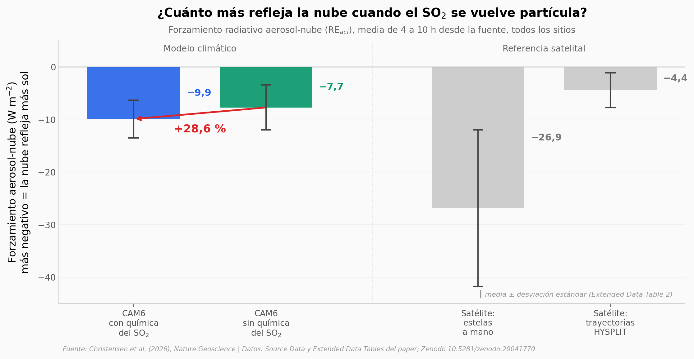

# Volcanes que pintan rayas en las nubes

Cuatro volcanes en islas remotas y dos fuentes industriales sueltan dióxido de azufre (SO₂), y las nubes que cruzan su pluma se ven como franjas más blancas desde el satélite. El equipo marcó a mano 281 de esas estelas en imágenes MODIS y las comparó con un modelo climático corrido con y sin la química que convierte el SO₂ en partículas de sulfato. Dentro de la estela la nube tiene más gotas en todos los tramos medidos con estelas a mano, y en el modelo esa química hace que la nube refleje más sol.

**El hallazgo:** **en el modelo CAM6, encender la química del SO₂ sube el forzamiento aerosol-nube de −7,7 a −9,9 W m⁻² (+28,6 %), el «29 %» del abstract**: un contraste entre simulaciones, con desviaciones que se solapan.

## Gráfica clave



## Reproducir

[](https://colab.research.google.com/github/Ciencia-a-Mordiscos/lab/blob/main/papers/2026-11-27-dioxido-azufre-brillo-nubes/notebook.ipynb)

O localmente:
```bash
pip install pandas matplotlib numpy scipy
jupyter execute notebook.ipynb
```

## Datos

- `datos/sitios.csv`: 6 sitios con SO₂ y estelas de la Extended Data Table 1 y gránulos MODIS con y sin estela (Zenodo)
- `datos/efectos_radiativos_edtab2.csv`: respuestas y forzamientos de la Extended Data Table 2, 28 filas (transcrita de imagen)
- `datos/satelite_nd_lwp_vs_tiempo.csv`: gotas y agua líquida en la estela frente a nube vecina, 110 filas (Source Data Fig. 3)
- `datos/cam6_kilauea_series.csv`: series CAM6 de Kīlauea con y sin química, 342 filas (Source Data Fig. 4)
- `datos/respuesta_por_sitio_dln.csv`: respuesta por sitio, 134 filas (Source Data Fig. 6)
- `datos/partmc_kilauea_100ppb.csv`: modelo de caja PartMC, 24 h, 435 filas (Source Data Fig. 5)
- `datos/error_hysplit_km.csv`: desvío de las trayectorias HYSPLIT, 744 valores (Source Data Extended Data Fig. 3a)
- `datos/emisiones_so2_kt_anio.csv`: emisiones anuales de SO₂ 2005-2022, 90 filas (Source Data Extended Data Fig. 1)

## Links

- **Video:** [Pendiente]
- **Paper:** [Nature Geoscience — DOI: 10.1038/s41561-026-02140-9](https://doi.org/10.1038/s41561-026-02140-9)
- **Datos originales:** [Zenodo](https://doi.org/10.5281/zenodo.20041770) · Source Data del paper
