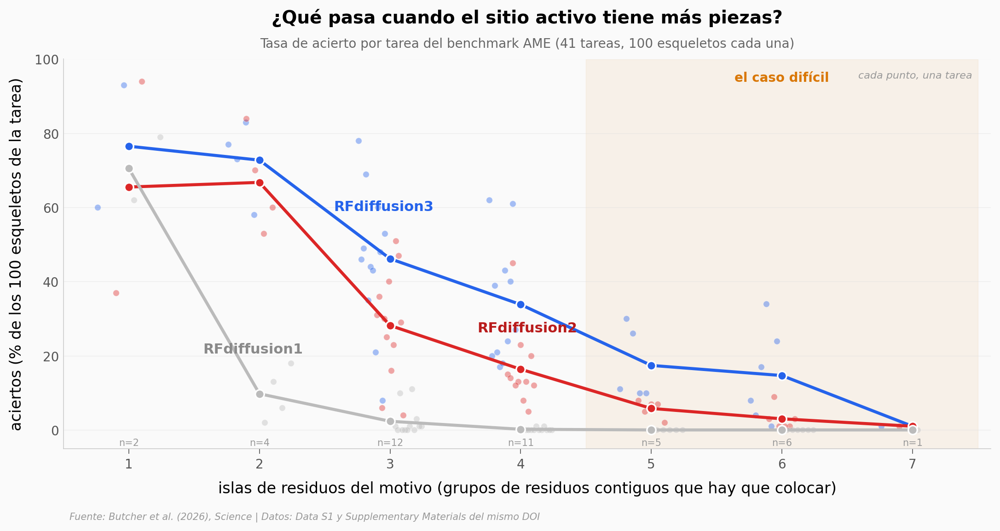

# RFdiffusion3: colocar átomos, no fragmentos

Diseñar una enzima desde cero es, sobre todo, un problema de sujeción: te dan el sitio activo y tienes que inventar la proteína que lo aguanta en la posición exacta. RFdiffusion3 (RFD3) ataca ese problema con difusión de átomos libres. En el benchmark AME de los autores —41 tareas, 100 esqueletos por tarea— acierta el 37,7 % de las veces frente al 23,5 % de RFdiffusion2, y la distancia se abre justo donde el sitio activo tiene más piezas. Después, con 96 diseños encargados y sin evolución dirigida, salieron catalizadores que funcionan.

**El hallazgo:** **con 1–4 islas de residuos la ventaja de RFD3 sobre RFD2 es de 1,50×; con 5–7 islas, de 3,67×.** Y la fosfotriesterasa diseñada, ZAPP-1, pierde entre 8,7× y 985× de eficiencia cuando se cambia por alanina cualquiera de las seis posiciones catalíticas: la química está donde el diseño decía.

## Gráfica clave



## Reproducir

[](https://colab.research.google.com/github/Ciencia-a-Mordiscos/lab/blob/main/papers/2026-11-27-rfdiffusion3-sitios-activos-atomicos/notebook.ipynb)

O localmente:
```bash
pip install pandas matplotlib numpy scipy
jupyter execute notebook.ipynb
```

## Datos

- `datos/ame_pass_rate_por_tarea.csv` — benchmark AME: 41 tareas, tasa de acierto de RFD3/RFD2/RFD1 y tasa de choques con el ligando, por número de islas de residuos
- `datos/velocidad_inferencia.csv` — segundos por diseño en GPUs A6000, a 50/100/200/400 residuos, para RFD1, RFD2, RFD3 y BoltzGen (Table S8)
- `datos/ame2_resumen_por_tarea.csv` — AME-2: 4 teozimas × 2 métodos, 16.000 diseños cada combinación; % bajo 1,25 Å y mediana del error
- `datos/ame2_rmsd_histograma.csv` — distribución del error de colocación de los 128.000 diseños de AME-2, agregada en bins de 0,05 Å
- `datos/zapp1_knockouts.csv` — ZAPP-1 y sus 6 mutantes de alanina: kcat/Km, kcat y si alcanzaron saturación (Table S3)
- `datos/zapp1_michaelis_menten.csv` — curva de Michaelis-Menten de ZAPP-1 sobre paraoxón, con y sin 25 mM de NaHCO₃ (6 concentraciones × 2 condiciones, n = 3)
- `datos/zapp1_mm_fit.csv` — parámetros del ajuste de esas dos curvas
- `datos/proteasas_mm_fit.csv` — las tres metaloproteasas de zinc contra transtiretina: kcat, Km y kcat/Km (Table S4)

## Links

- **Video:** [Pendiente]
- **Paper:** [Science — DOI: 10.1126/science.aeh2982](https://doi.org/10.1126/science.aeh2982)
- **Datos originales:** [Data S1 y Supplementary Materials del mismo DOI](https://www.science.org/doi/10.1126/science.aeh2982)
